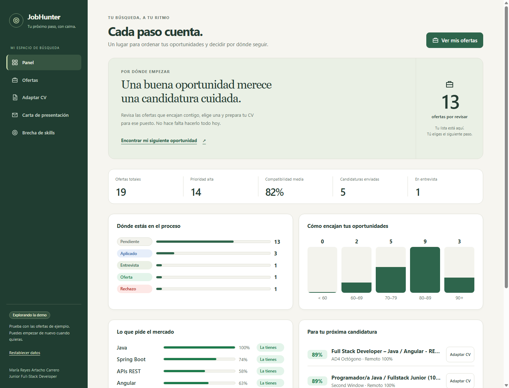
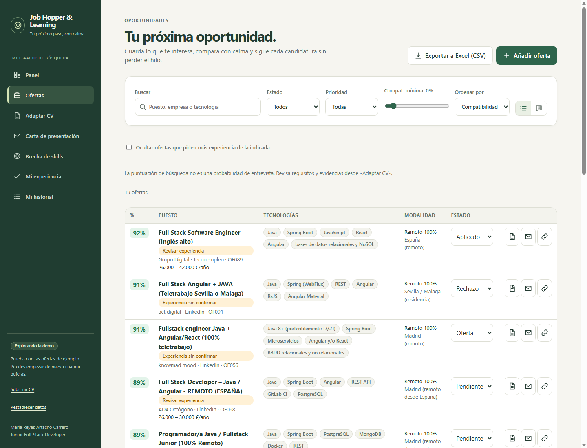
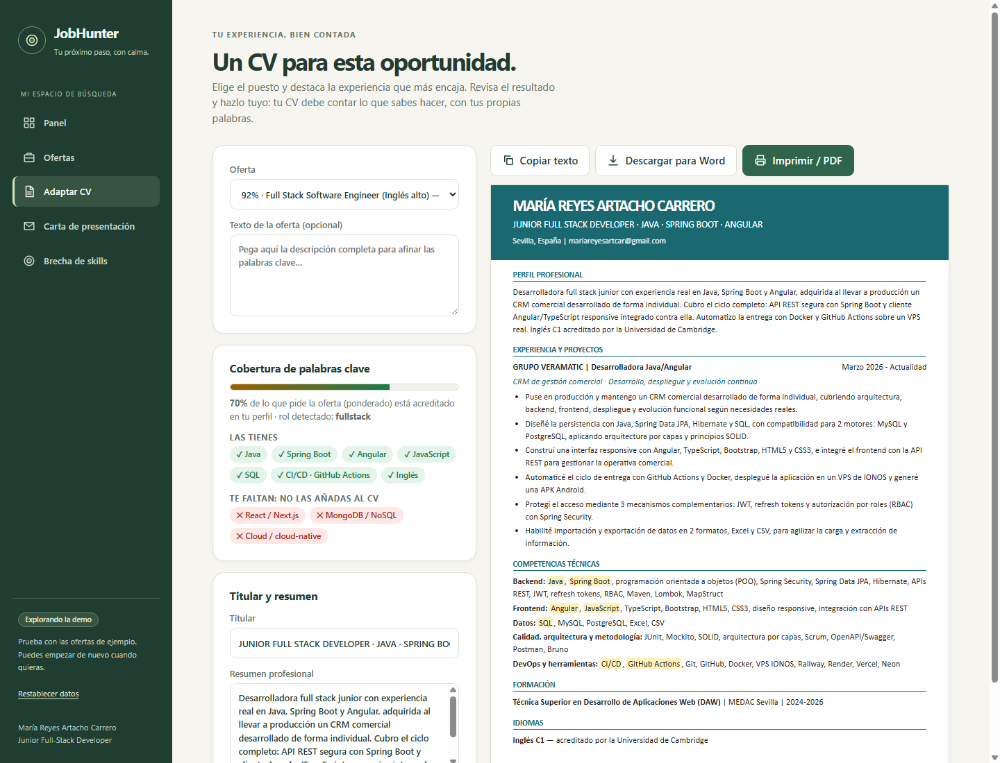
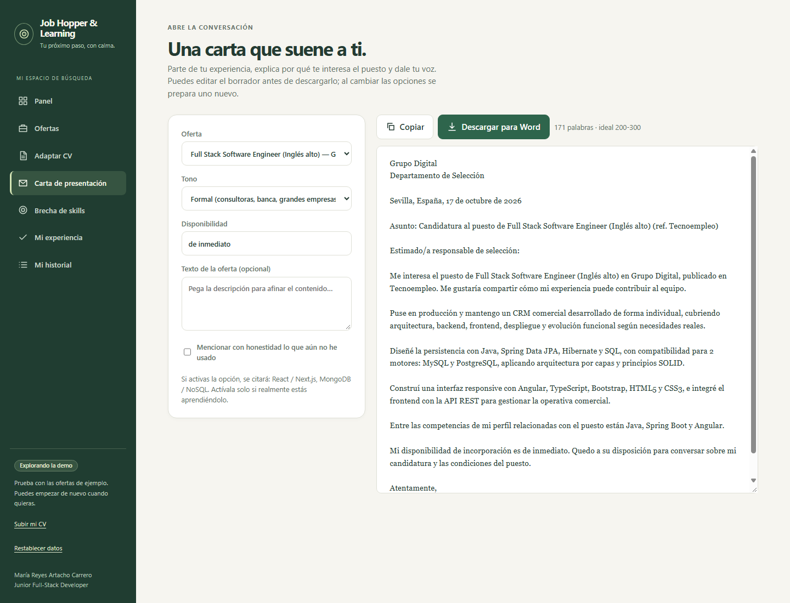
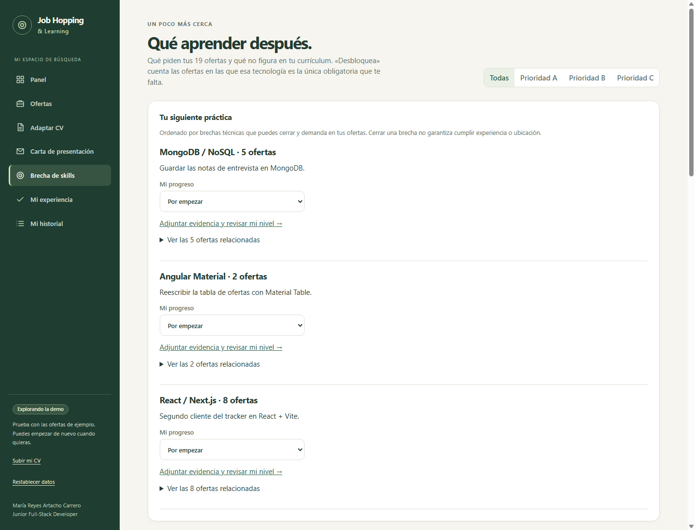
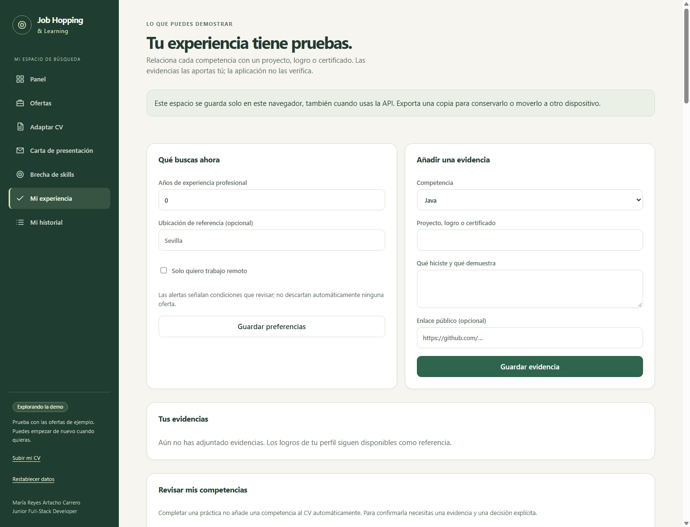
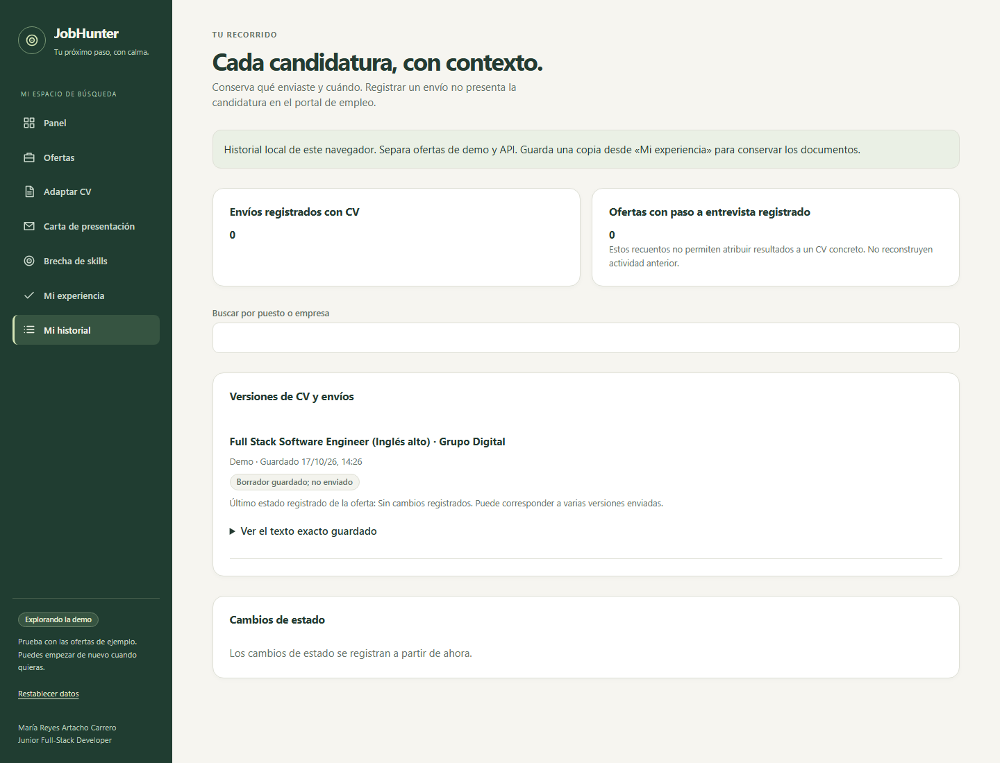

# Job Hopping & Learning

**IT job search manager built with Angular, TypeScript, and Python (FastAPI).** Track applications, score job offers against a candidate profile, tailor CVs, generate cover letters, and identify skills gaps.

[](https://github.com/reyes-art-car/job-scout/actions/workflows/ci.yml)




**Bring your own CV.** The landing page lets anyone upload a PDF, DOCX or TXT résumé. It is read in the browser (`pdfjs-dist`, `fflate`), turned into an editable profile and stored in `localStorage`; the sample offers are re-scored against that profile. Nothing is sent to a server, so there are no accounts. A "Borrar mis datos" button erases everything, and the app ships Spanish legal pages (aviso legal, privacidad, cookies, condiciones de uso).

## Features

| Area | What it does |
| --- | --- |
| **Dashboard** | Application pipeline metrics, recruitment funnel, compatibility distribution, and the most requested technologies |
| **Job offers** | Filterable table and drag-and-drop Kanban board, manual entry with estimated compatibility, and Excel-compatible CSV export |
| **CV tailoring** | Detects technologies in an offer, prioritizes relevant achievements and skills, and suggests a headline and summary using only experience supported by the profile |
| **Cover letters** | Editable letters based on the offer and profile, with formal or conversational wording and the option to acknowledge skills still being learned |
| **Skills gap analysis** | Highlights missing technologies, their priority, the offers they could unlock, and ways to demonstrate proficiency |
| **Search automation** | Uses Claude Code to search for offers, apply a 100-point scoring rubric, update a spreadsheet without duplicate URLs, and generate tailored CV documents |

The frontend exports Word-compatible HTML and supports PDF output through the browser print dialog. The Python automation generates `.docx` files.

<table>
  <tr>
    <td></td>
    <td></td>
  </tr>
  <tr>
    <td></td>
    <td></td>
  </tr>
  <tr>
    <td></td>
    <td></td>
  </tr>
</table>

## Evidence-based job search

- Inspect requirement sources and weights, correct their classification, and distinguish technical coverage from interview probability.
- Attach projects, achievements, and certificates to skills. Confirm new competencies explicitly before including them in the CV.
- Track learning progress against the offers that need each skill, with links to the relevant opportunities.
- Review experience, seniority, location, and remote-work warnings separately from the technical score.
- Save CV versions, register applications, review seven-day follow-up dates, and retain a local status history.

The career workspace is stored in your browser, including when offers come from the API. Export or restore a JSON backup from **Mi experiencia** to retain it across devices. See the [workflow and limitations](docs/EVIDENCE_BASED_SEARCH.md).

## Technology stack

| Layer | Technologies |
| --- | --- |
| Frontend | Angular 20, TypeScript, signals, standalone components, SCSS, Karma/Jasmine |
| Backend | Python, FastAPI, Pydantic, SQLAlchemy 2, SQLite, pytest |
| Automation | Claude Code, openpyxl, python-docx, a modular `jobsearch` package, Windows Task Scheduler |
| Quality and security | Ruff, mypy strict mode, Bandit, ESLint, pip-audit, Gitleaks, CodeQL, Dependabot |
| Delivery | GitHub Actions, GitHub Pages demo, Docker Compose, unprivileged nginx |

## Architecture and design

- **Hexagonal backend architecture:** framework-independent domain entities and small repository ports, with application use cases and infrastructure adapters. See the [architecture documentation](docs/ARCHITECTURE.md).
- **API and demo gateways:** the frontend accesses offers through an abstraction, with API access and a browser-persisted demo implementation.
- **Testable CV tailoring:** pure functions analyze offer requirements and prioritize profile content without inventing qualifications.
- **Security controls:** bearer authentication when a token is configured, mandatory token configuration in production, request size and rate limits, input sanitization, security headers, and validation of browser storage and model output. See the [security implementation and limitations](docs/SECURITY.md).
- **Separated automation stages:** configuration, prompts, model execution, parsing, spreadsheet storage, document generation, and reporting have dedicated modules.

## Run locally

Prerequisites: Node.js 22, Python 3.11 or later, and Chrome or Chromium for frontend tests. Python 3.13 is used in CI.

### Backend

From the repository root, run the following in PowerShell:

```powershell
cd backend
python -m venv .venv
.\.venv\Scripts\Activate.ps1
python -m pip install -r requirements-dev.txt
python -m pip install -e .
Copy-Item .env.example .env
python scripts/seed.py --demo
uvicorn job_tracker.main:app --reload
```

On Linux or macOS, activate the environment with `source .venv/bin/activate` and copy the configuration with `cp .env.example .env`.

The development API runs at `http://localhost:8000`, with interactive documentation at `http://localhost:8000/docs`. To import your own spreadsheet, run `python scripts/seed.py --excel path/to/Offers.xlsx` from `backend/`.

Local development can run without an API token. If `API_TOKEN` is configured, enter it in the frontend sidebar; it is stored in `sessionStorage` and sent only to `/api/` requests. Production requires `APP_ENV=production` and an API token of at least 32 characters.

### Frontend

In a separate terminal, from the repository root:

```powershell
cd frontend
npm ci
npm start
```

Open `http://localhost:4200`. Development requests to `/api` are proxied to port 8000. The backend is optional for trying the application with demo data.

### Search automation

Install `automation/requirements.txt` and configure an authenticated Claude Code installation. See the [automation setup guide](automation/README.md) for search modes, candidate configuration, and Windows scheduling.

### Containers

Copy `backend/.env.example` to `backend/.env`, configure a production API token, and run from the repository root:

```powershell
docker compose -f infra/docker-compose.yml up --build
```

The web interface is exposed at `http://localhost:8080`; the API is accessed through nginx. The reference stack uses unprivileged containers, a persistent database volume, and read-only container filesystems. Container execution has not yet been validated locally.

## Tests and quality checks

Run each group from its respective directory, with its dependencies installed. The backend development environment provides the Python quality tools; automation also needs `automation/requirements.txt`.

```powershell
# backend/
python -m ruff check src tests scripts
python -m ruff format --check src tests scripts
python -m mypy
python -m bandit -q -r src
python -m pytest -q --cov=job_tracker --cov-fail-under=85

# automation/
python -m ruff check .
python -m pytest -q

# frontend/
npm run lint
npm test -- --watch=false --browsers=ChromeHeadless
npm run build
```

Latest local validation: **81 backend tests passed, 78 automation tests passed, and 95 frontend tests passed**. One additional backend test was skipped because creating symbolic links requires privileges on the Windows test machine. Backend coverage was **93.06%**. Linting, formatting, type checks, Bandit, and the production frontend build also passed.

GitHub Actions is configured to run quality checks, dependency audits, secret scanning, and CodeQL analysis. See [CONTRIBUTING.md](CONTRIBUTING.md) for local commit hooks and contribution conventions.

## Repository structure

```text
frontend/          Angular application, offer gateways, CV tools, and tests
backend/           FastAPI domain, application, infrastructure, API, and tests
automation/        Modular jobsearch package, CLI, prompts, and scheduling
data/demo/         Sample offers and a candidate profile used by the demo
infra/             nginx configuration and reference Docker Compose stack
docs/              Architecture, security, roadmap, and market analysis
.github/workflows/ Quality checks, security scans, and demo deployment
```

## Documentation

Most detailed guides are currently in Spanish.

- [Architecture and SOLID principles](docs/ARCHITECTURE.md)
- [Security controls and limitations](docs/SECURITY.md)
- [Vulnerability disclosure policy](SECURITY.md)
- [Contributing](CONTRIBUTING.md)
- [Branch organization and development workflow](docs/DEVELOPMENT_WORKFLOW.md)
- [Roadmap and suggested improvements](docs/ROADMAP.md)
- [Skills gap and market analysis](docs/SKILLS_GAP.md)
- [Job search report — October 17, 2026](docs/BUSQUEDA_2026-10-17.md)

## Data and privacy

Generated CVs, letters, personal offer spreadsheets, logs, credentials, and the private candidate configuration are excluded from version control through `.gitignore`. Optional local hooks and CI secret scanning add checks for sensitive files and credential patterns.

The public demo includes sample job offers and the author's professional profile, including public contact information. To configure the backend and automation for your own use, copy `backend/config/candidate_profile.example.yaml` to `backend/config/candidate_profile.yaml`. The frontend profile is loaded separately from `data/demo/profile.json`; review it before publishing a customized demo.

## Author

**María Reyes Artacho Carrero** · Junior full-stack developer (Java, Spring Boot, Angular) · Seville, Spain

[LinkedIn](https://www.linkedin.com/in/maria-reyes-a-carrero/) · [Email](mailto:mariareyesartcar+github@gmail.com)

Software propietario: todos los derechos reservados. Consulta [LICENSE](LICENSE).
