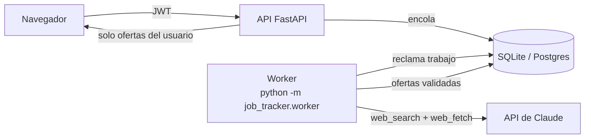

# Multiusuario y búsqueda con la API de Claude

Hasta ahora la aplicación era de una sola persona: la búsqueda de ofertas la lanzaba un script con Claude Code y la
suscripción personal, y todas las ofertas vivían en un único Excel/SQLite. Ahora cualquier usuario puede registrarse,
rellenar su perfil y pedir una búsqueda propia.



## Qué cambia

| Antes | Ahora |
|---|---|
| Un token compartido (`API_TOKEN`) | Cuentas con email y contraseña (scrypt) y sesión JWT de 12 h |
| Perfil de una persona en un YAML | Perfil de búsqueda por usuario (`PUT /api/profile`) |
| Búsqueda por línea de comandos con tu suscripción | `POST /api/searches` encola; el worker llama a la API de Claude |
| Ofertas globales | Todas las tablas llevan `user_id`; código `OF001` y URL son únicos **por usuario** |
| Sin límites de uso | Cupo mensual por plan, una búsqueda a la vez por usuario |

`automation/` sigue funcionando para uso personal con Claude Code. No se usa en el servicio: la suscripción de Claude
es personal y no se puede revender ni ofrecer a terceros.

## API

| Método y ruta | Público | Descripción |
|---|---|---|
| `POST /api/auth/register` | sí | Crea la cuenta (plan `free`) y devuelve la sesión |
| `POST /api/auth/login` | sí | Devuelve la sesión. Mismo error para email y contraseña incorrectos |
| `GET /api/auth/me` | no | Email, plan y cupo (`limit`, `used`, `remaining`) |
| `GET/PUT /api/profile` | no | Perfil de búsqueda (`null` si aún no existe) |
| `POST /api/searches` | no | Encola una búsqueda (`general`, `linkedin`, `europa`). 202 |
| `GET /api/searches[/{id}]` | no | Estado: `queued`, `running`, `done`, `failed` |
| `/api/offers…` | no | Igual que antes, pero acotado a la cuenta |

Errores propios: `402` cupo agotado, `409` falta el perfil o ya hay una búsqueda en curso, `403` registro cerrado,
`429` demasiados intentos de login (10 por IP y minuto).

## Cupo y planes

El plan vive en `users.plan` (`free` o `pro`) y su cupo mensual en `FREE_SEARCHES_PER_MONTH` /
`PRO_SEARCHES_PER_MONTH`. **No hay pasarela de pago todavía:** para dar el plan `pro` a alguien, de momento se cambia a
mano en la base de datos. Una futura integración con Stripe solo tendría que cambiar esa columna (por ejemplo desde un
webhook); el resto del sistema ya depende únicamente del plan.

Las búsquedas fallidas no consumen cupo. Un trabajo «en curso» que lleva más de `STALE_JOB_MINUTES` (30) se marca como
fallido, por ejemplo si el worker se cayó.

## Cómo fijar el precio con datos

Cada trabajo guarda lo que ha consumido de verdad en `search_jobs`: `input_tokens`, `output_tokens`, `web_searches` y
`web_fetches`. No se muestran al usuario. Para calcular el coste medio de una búsqueda:

```sql
SELECT strategy,
       COUNT(*)            AS busquedas,
       AVG(input_tokens)   AS entrada_media,
       AVG(output_tokens)  AS salida_media,
       AVG(web_searches)   AS busquedas_web_medias,
       AVG(web_fetches)    AS lecturas_web_medias
FROM search_jobs
WHERE status = 'done'
GROUP BY strategy;
```

Con esas medias y las tarifas vigentes de la API (por millón de tokens y por búsqueda web, en la página de precios de
Anthropic) sale el coste real de una búsqueda:

> coste = entrada × precio_entrada + salida × precio_salida + búsquedas_web × tarifa_búsqueda_web

Plan de trabajo recomendado antes de poner precio: ejecutar 10-20 búsquedas reales con tu propia cuenta, sacar la
media y el máximo, y fijar el precio de la suscripción para cubrir `PRO_SEARCHES_PER_MONTH` búsquedas con margen,
más hosting, comisión de la pasarela e impuestos. Los topes `SEARCH_MAX_WEB_SEARCHES`, `SEARCH_MAX_WEB_FETCHES` y
`SEARCH_MAX_TOKENS` acotan el coste máximo de una sola búsqueda.

## Puesta en marcha

```bash
cd backend
cp .env.example .env     # JWT_SECRET, ANTHROPIC_API_KEY y APP_ENV=production
uvicorn job_tracker.main:app          # la API
python -m job_tracker.worker          # el worker (otro proceso o servicio)
```

Con Docker: `docker compose -f infra/docker-compose.yml up --build` levanta API, worker y nginx.

### Migrar una base de datos existente

La base de un solo usuario no se actualiza sola: las columnas y restricciones únicas cambian.

```bash
python scripts/migrate_to_multiuser.py --email tu@correo.com
```

Todas las ofertas y entrevistas existentes pasan a esa cuenta. El script hace antes una copia `.bak` y la restaura si algo
falla. También puedes partir de cero e importar el Excel: `python scripts/seed.py --email tu@correo.com --excel ...`.

## Limitaciones conocidas

- **Frontend:** tiene acceso con email, perfil de búsqueda y lanzador de búsquedas con seguimiento del estado
  (`/acceso` y `/buscar`). Está probado con tests unitarios y de servicio, no con un navegador contra un backend con
  clave real.
- **No probado contra la API real de Claude:** el cliente (`infrastructure/llm/anthropic_search.py`) está probado con
  respuestas simuladas, no con una clave real. Haz una búsqueda de prueba y revisa `search_jobs` antes de abrirlo.
- **Base de datos:** SQLite basta para empezar (API y worker comparten el volumen). Con tráfico real conviene Postgres;
  hace falta añadir el driver y probar el reclamo de trabajos, que ya es atómico.
- **Límite de ritmo:** está en memoria y por proceso. Con varias réplicas de la API habría que moverlo a Redis o a nginx.
- **Sin recuperación de contraseña ni verificación de email.** Antes de cobrar hacen falta ambas.
- **Sin pagos, facturación ni textos legales** (RGPD, términos, privacidad): se guardan CV y datos personales.
- **El perfil es texto libre del usuario** y va dentro del prompt. Está delimitado y marcado como dato no confiable, pero
  un usuario solo puede perjudicar sus propios resultados; el cupo y los topes limitan el gasto.
